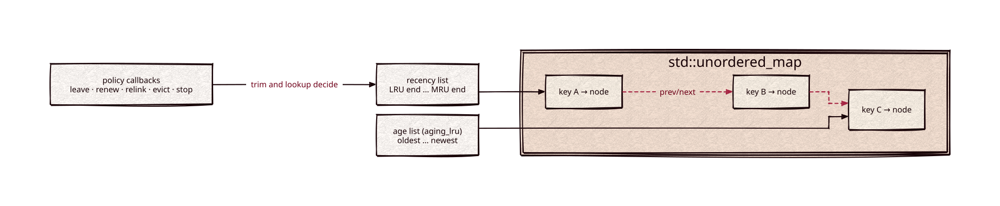

# lru-cache

[](https://github.com/Kronuz/lru-cache/actions/workflows/ci.yml)
[](LICENSE)


A header-only LRU cache for C++17 with optional time-to-live eviction and
policy callbacks: O(1) lookup and reordering, and you decide, entry by entry,
whether to keep, renew, or evict. For caching derived data (schemas, compiled
scripts, parsed configs) without pulling in a framework.



## ✨ Highlights

- **O(1) everything.** Values live in a `std::unordered_map`; an intrusive
  doubly-linked list through its nodes tracks recency.
- **Time-to-live eviction.** `aging_lru` adds a second, age-ordered list and
  expires entries after `max_age`.
- **Your eviction policy.** The `*_and` methods take a callback that returns
  `leave`, `renew`, `relink`, `evict`, or `stop` per entry.
- **Peek without touching.** `exists` and `find_and_leave` look without renewing.
- **One header, no dependencies.**

## 📦 Installation

Requires a C++17 compiler; CMake 3.14 or newer for the CMake route. CI builds it
on Linux (x86_64, arm64), macOS (arm64, x86_64), and FreeBSD, plus ASan, UBSan,
and TSan builds.

```cmake
include(FetchContent)
FetchContent_Declare(lru_cache
  GIT_REPOSITORY https://github.com/Kronuz/lru-cache.git
  GIT_TAG        main)
FetchContent_MakeAvailable(lru_cache)

target_link_libraries(my_app PRIVATE lru_cache::lru_cache)
```

Or copy `lru.h` onto your include path.

## 🚀 Quick start

```cpp
#include "lru.h"

#include <chrono>
#include <string>

using namespace std::chrono_literals;

int main() {
	lru::lru<int, std::string> cache(2);       // capacity 2; 0 means unbounded
	cache.emplace(1, "one");
	cache.emplace(2, "two");
	cache.find(1);                             // a hit renews 1
	cache.emplace(3, "three");                 // trims the least recent: 2

	lru::aging_lru<std::string, std::string> sessions(1000, 30s);   // 30 s TTL
	sessions.emplace("token", "user-42");
	sessions.trim();                           // drops whatever expired
}
```

[`examples/demo.cc`](examples/demo.cc) prints the cache after every operation, so
you can watch recency decide who stays.

## 🎯 When to use it

- ✅ A bounded cache with LRU, TTL, or your own mix of the two.
- ❌ Shared across threads as is: there is no internal locking; guard it yourself.
- ❌ A hard capacity at every instant: the cache trims before an insert, so right
  after an overflowing insert it can hold one extra entry until the next trim.

## 📚 Documentation

- [docs/API.md](docs/API.md): construction, insertion, lookup, the callbacks,
  removal, iteration, and caveats.
- [ARCHITECTURE.md](ARCHITECTURE.md): the node layout, the two lists, and how
  trimming walks them.
- [AGENTS.md](AGENTS.md): repository map, invariants, and traps.

## 🛠️ Building and testing

```sh
cmake -B build && cmake --build build && ctest --test-dir build
./build/lru_cache_demo
```

The iterator still derives from the deprecated `std::iterator`, so builds print
one `-Wdeprecated-declarations` warning.

## 🤝 Contributing

Issues and pull requests are welcome. Read [AGENTS.md](AGENTS.md) first. CI must
pass on every platform.

## 📄 License

MIT, Copyright (c) 2015-2019 Dubalu LLC. See [LICENSE](LICENSE). Extracted from
[Xapiand](https://github.com/Kronuz/Xapiand), where it caches schemas and compiled
scripts.
