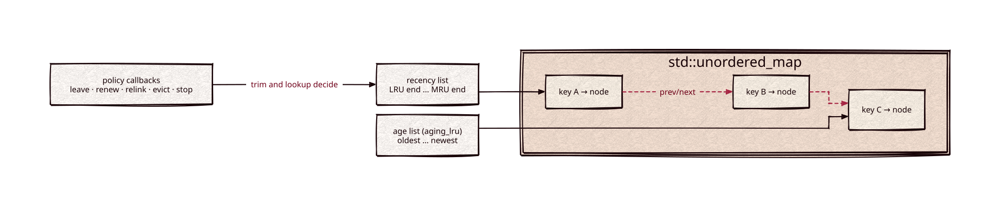

# lru-cache

Part of [Kronuz C++ Libraries](https://github.com/Kronuz/cpp-libraries), a collection of small, reusable C++ libraries.

[](https://github.com/Kronuz/lru-cache/actions/workflows/ci.yml)
[](LICENSE)


A header-only LRU cache for C++17 with optional time-to-live eviction and
policy callbacks: O(1) lookup and reordering, and you decide, entry by entry,
whether to keep, renew, or evict. For caching derived data (schemas, compiled
scripts, parsed configs) without pulling in a framework.



## ✨ Highlights

- **O(1) everything.** Values live in a `std::unordered_map`; an intrusive
  doubly-linked list through its nodes tracks recency.
- **Time-to-live eviction.** `aging_lru` adds a second, age-ordered list and
  expires entries after `max_age`.
- **Your eviction policy.** The `*_and` methods take a callback that returns
  `leave`, `renew`, `relink`, `evict`, or `stop` per entry.
- **Peek without touching.** `exists` and `find_and_leave` look without renewing.
- **One header, no dependencies.**

## 📦 Installation

Requires a C++17 compiler; CMake 3.14 or newer for the CMake route. CI builds it
on Linux (x86_64, arm64), macOS (arm64, x86_64), and FreeBSD, plus ASan, UBSan,
and TSan builds.

```cmake
include(FetchContent)
FetchContent_Declare(lru_cache
  GIT_REPOSITORY https://github.com/Kronuz/lru-cache.git
  GIT_TAG        main)
FetchContent_MakeAvailable(lru_cache)

target_link_libraries(my_app PRIVATE lru_cache::lru_cache)
```

Or copy `lru.h` onto your include path.

## 🚀 Quick start

```cpp
#include "lru.h"

#include <chrono>
#include <string>

using namespace std::chrono_literals;

int main() {
	lru::lru<int, std::string> cache(2);       // capacity 2; 0 means unbounded
	cache.emplace(1, "one");
	cache.emplace(2, "two");
	cache.find(1);                             // a hit renews 1
	cache.emplace(3, "three");                 // trims the least recent: 2

	lru::aging_lru<std::string, std::string> sessions(1000, 30s);   // 30 s TTL
	sessions.emplace("token", "user-42");
	sessions.trim();                           // drops whatever expired
}
```

[`examples/demo.cc`](examples/demo.cc) prints the cache after every operation, so
you can watch recency decide who stays.

## 🎯 When to use it

- ✅ A bounded cache with LRU, TTL, or your own mix of the two.
- ❌ Shared across threads as is: there is no internal locking; guard it yourself.
- ❌ A hard capacity at every instant: the cache trims before an insert, so right
  after an overflowing insert it can hold one extra entry until the next trim.

## ⚡ Performance

`bench/bench.cc` runs `find_and_renew` and `emplace` on a miss over keys skewed towards small
values, drawn from twice the capacity, so about half the lookups hit; ns per operation, best of 5,
two runs each. The comparator is the textbook LRU, a `std::list` of entries and a
`std::unordered_map` from key to list iterator, built with the capacity plus one because `emplace`
trims before it inserts; the hit counts of the two agree.

Apple M4 Pro (arm64, Apple clang 17.0.0), `lru::lru` / textbook:

| keys | capacity | ns per operation | ratio |
|---|---|---|---|
| `uint64_t` | 1024 | 23.4, 23.3 / 26.0, 28.8 | 1.11, 1.24 |
| `uint64_t` | 65536 | 34.5, 33.7 / 45.8, 45.6 | 1.33, 1.35 |
| `uint64_t` | 1048576 | 125.5, 98.8 / 140.1, 115.5 | 1.12, 1.17 |
| `std::string` | 65536 | 77.7, 73.0 / 95.9, 80.9 | 1.23, 1.11 |

Intel i9-9980HK (x86_64, Apple clang 17.0.0):

| keys | capacity | ns per operation | ratio |
|---|---|---|---|
| `uint64_t` | 1024 | 94.2, 90.3 / 94.9, 87.4 | 1.01, 0.97 |
| `uint64_t` | 65536 | 251.9, 236.2 / 279.1, 273.5 | 1.11, 1.16 |
| `uint64_t` | 1048576 | 331.1, 333.0 / 335.1, 328.8 | 1.01, 0.99 |
| `std::string` | 65536 | 260.8, 266.4 / 439.4, 442.5 | 1.69, 1.66 |

The nodes live in the map, so a lookup is one hash and one node, and renewing is a relink of
pointers already in hand. At a million entries both caches spend their time on cache misses in the
hash table and the gap closes.

```sh
cmake -B build -DCMAKE_BUILD_TYPE=Release -DLRU_CACHE_BUILD_BENCH=ON
cmake --build build --target lru_cache_bench && ./build/lru_cache_bench
```

## 📚 Documentation

- [docs/API.md](docs/API.md): construction, insertion, lookup, the callbacks,
  removal, iteration, and caveats.
- [ARCHITECTURE.md](ARCHITECTURE.md): the node layout, the two lists, and how
  trimming walks them.
- [AGENTS.md](AGENTS.md): repository map, invariants, and traps.

## 🛠️ Building and testing

```sh
cmake -B build && cmake --build build && ctest --test-dir build
./build/lru_cache_demo
```

The iterator still derives from the deprecated `std::iterator`, so builds print
one `-Wdeprecated-declarations` warning.

## 🤝 Contributing

Issues and pull requests are welcome. Read [AGENTS.md](AGENTS.md) first. CI must
pass on every platform.

## 📄 License

MIT, Copyright (c) 2015-2019 Dubalu LLC. See [LICENSE](LICENSE). Extracted from
[Xapiand](https://github.com/Kronuz/Xapiand), where it caches schemas and compiled
scripts.

`erase(key)` reports one removed entry even when the cache becomes empty; a missing key reports zero. See the [removal API](docs/API.md#removal).
